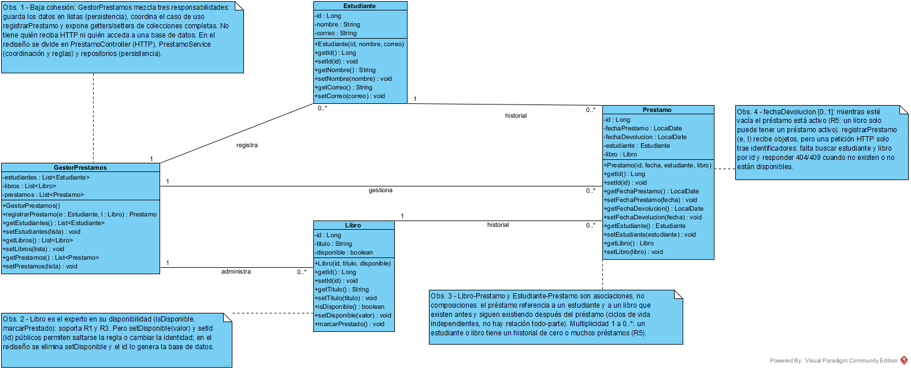
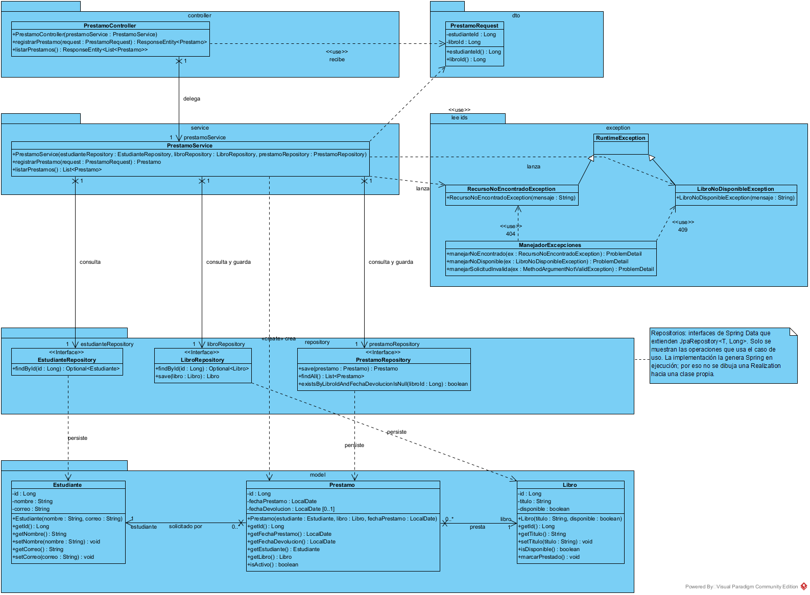
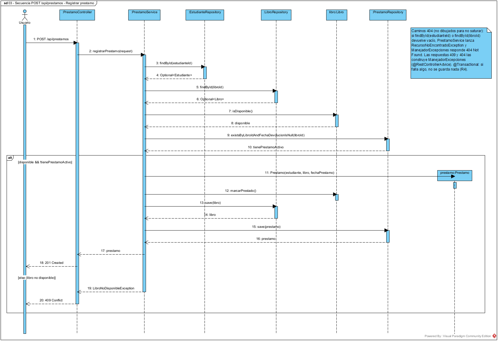

# Taller práctico Bloque 7 · SmartLibrary

**Del modelo de clases orientado a objetos a un diseño por tres capas para una API REST con Spring Boot.**

Caso de uso implementado: **Registrar préstamo** (`POST /api/prestamos`) y **consulta de préstamos** (`GET /api/prestamos`).

| | |
|---|---|
| **Estudiante** | Cristhian Santiago Parra Erazo · ID 926222 |
| **Asignatura** | Diseño de Software · Cuarto semestre |
| **Docente** | Miguel Tovar |
| **Institución** | Universidad Cooperativa de Colombia · Campus Pasto, Nariño |

---

## Estructura del repositorio

```text
TallerPractico7-SmartLibrary/
├── README.md
├── docs/
│   └── Taller7_SmartLibrary_ParraErazo_926222.docx   ← documento de entrega
├── diagramas/
│   ├── vpp/                                          ← proyectos de Visual Paradigm 18.1
│   │   ├── 01-modelo-inicial-anotado.vpp
│   │   ├── 02-clases-por-capas.vpp
│   │   └── 03-secuencia-registrar-prestamo.vpp
│   └── img/                                          ← diagramas exportados (PNG)
├── evidencias/
│   ├── resultado-pruebas.txt                         ← salida de ./mvnw test
│   └── pruebas-http.txt                              ← peticiones curl contra la API en ejecución
└── smartlibrary-api/                                 ← proyecto Spring Boot
    ├── pom.xml
    ├── mvnw / mvnw.cmd
    └── src/
        ├── main/java/co/edu/ucc/smartlibrary/
        │   ├── controller/   PrestamoController
        │   ├── service/      PrestamoService
        │   ├── repository/   EstudianteRepository, LibroRepository, PrestamoRepository
        │   ├── model/        Estudiante, Libro, Prestamo
        │   ├── dto/          PrestamoRequest
        │   └── exception/    RecursoNoEncontradoException, LibroNoDisponibleException, ManejadorExcepciones
        ├── main/resources/   application.properties, data.sql
        └── test/java/...     PrestamoControllerTest
```

## Reglas de negocio

| Id | Regla |
|---|---|
| R1 | Solo un libro disponible puede prestarse. |
| R2 | El préstamo registra estudiante, libro y fecha. |
| R3 | Al prestarlo, el libro deja de estar disponible. |
| R4 | Una solicitud inválida no debe crear préstamo. |
| R5 | Un libro puede tener varios préstamos históricos, pero solo uno activo a la vez (activo = `fechaDevolucion` vacía). |

## Diagramas

### 01 · Modelo inicial anotado (Actividad 1)
Modelo del enunciado con las observaciones de diseño como notas.



### 02 · Modelo de clases por capas (Actividad 3)
Controller → Service → Repository, más el modelo de dominio, el DTO de entrada y las excepciones. Los paquetes del diagrama son los mismos paquetes del código.



### 03 · Secuencia `POST /api/prestamos` (Actividad 4)
Fragmento `alt` con los caminos **préstamo exitoso** y **libro no disponible**. Cada mensaje corresponde a una operación del diagrama 02.



## Ejecutar el proyecto

Requisitos: **JDK 21 o superior**. No hace falta instalar Maven porque se incluye el *Maven Wrapper*.

```bash
cd smartlibrary-api

# Pruebas automáticas (6 escenarios + arranque)
./mvnw test            # Windows: mvnw.cmd test

# Levantar la API en http://localhost:8080
./mvnw spring-boot:run # Windows: mvnw.cmd spring-boot:run
```

> Si el puerto 8080 está ocupado: `./mvnw spring-boot:run -Dspring-boot.run.arguments=--server.port=8081`

Consola de H2: `http://localhost:8080/h2-console` (JDBC URL `jdbc:h2:mem:smartlibrary`, usuario `sa`, sin contraseña).

### Datos iniciales (`data.sql`)

| Estudiantes | Libros |
|---|---|
| 1 · Ana Gomez | 1 · Diseno de Software (disponible) |
| 2 · Luis Martinez | 2 · Patrones de Diseno (disponible) |
| | 3 · UML Distilled (**prestado**, con préstamo activo) |

## API

| Método | Ruta | Cuerpo | Respuestas |
|---|---|---|---|
| `POST` | `/api/prestamos` | `{"estudianteId": 1, "libroId": 1}` | `201` creado · `400` solicitud inválida · `404` estudiante o libro inexistente · `409` libro no disponible |
| `GET` | `/api/prestamos` | — | `200` lista de préstamos |

```bash
curl -i -X POST http://localhost:8080/api/prestamos \
     -H "Content-Type: application/json" \
     -d '{"estudianteId": 1, "libroId": 1}'
```

Los errores se devuelven en formato `ProblemDetail` (`application/problem+json`).

## Escenarios de prueba (Actividad 6)

| Escenario | Esperado | Prueba automática |
|---|---|---|
| Préstamo de libro disponible | 201 Created y préstamo registrado | `registrarPrestamoLibroDisponible` ✔ |
| Libro ya prestado | 409 Conflict, sin nuevo préstamo | `registrarPrestamoLibroNoDisponible` ✔ |
| Estudiante inexistente | 404 Not Found | `registrarPrestamoEstudianteInexistente` ✔ |
| Libro inexistente | 404 Not Found | `registrarPrestamoLibroInexistente` ✔ |
| Consulta de préstamos | 200 OK con registros | `listarPrestamos` ✔ |
| Extra: solicitud sin `libroId` (R4) | 400 Bad Request, sin préstamo | `registrarPrestamoSolicitudInvalida` ✔ |

Evidencias: [`evidencias/resultado-pruebas.txt`](evidencias/resultado-pruebas.txt) y [`evidencias/pruebas-http.txt`](evidencias/pruebas-http.txt).

## Trazabilidad requisito → clase → operación → prueba

| Regla | Clase | Operación | Prueba |
|---|---|---|---|
| R1 | `Libro`, `PrestamoService` | `isDisponible()`, `registrarPrestamo()` | `registrarPrestamoLibroNoDisponible` |
| R2 | `Prestamo`, `PrestamoService` | `Prestamo(estudiante, libro, fechaPrestamo)` | `registrarPrestamoLibroDisponible` |
| R3 | `Libro` | `marcarPrestado()` | `registrarPrestamoLibroDisponible` |
| R4 | `PrestamoRequest`, `ManejadorExcepciones`, `PrestamoService` | `@NotNull`/`@Valid`, `manejarSolicitudInvalida()`, `@Transactional` | `registrarPrestamoSolicitudInvalida` y los escenarios 404 |
| R5 | `PrestamoRepository`, `Prestamo` | `existsByLibroIdAndFechaDevolucionIsNull()`, `isActivo()` | `registrarPrestamoLibroNoDisponible`, `listarPrestamos` |

## Decisiones de diseño (resumen)

1. **Tres capas y un modelo de dominio**, con dependencias en una sola dirección: Controller → Service → Repository. El Controller nunca usa un Repository.
2. **La regla vive donde está la información:** `Libro` controla su disponibilidad (GRASP Experto) y `PrestamoService` decide y coordina el caso de uso (GRASP Controlador). Se eliminó `setDisponible()`.
3. **DTO de entrada** `PrestamoRequest(estudianteId, libroId)`, validado con `@NotNull`.
4. **`@Transactional`:** el cambio de disponibilidad y la creación del préstamo se guardan juntos o no se guarda ninguno.
5. **Errores explícitos:** las excepciones del dominio se traducen a 404, 409 y 400 en un solo lugar (`ManejadorExcepciones`).
6. **Repositorios como interfaces de Spring Data.** No se dibuja realización porque la implementación la genera el framework.

La justificación completa está en [`docs/Taller7_SmartLibrary_ParraErazo_926222.docx`](docs/Taller7_SmartLibrary_ParraErazo_926222.docx).

## Tecnologías

Java 21 · Spring Boot 4.1.2 (Web MVC, Data JPA, Validation) · H2 · JUnit 5 + MockMvc · Maven Wrapper · Visual Paradigm 18.1 Community Edition
